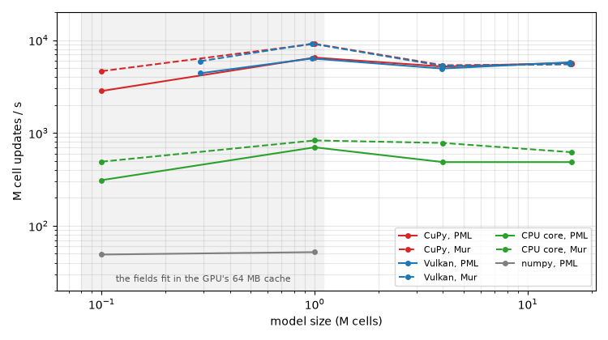

# gfdtd

A 3D FDTD solver in the manner of openEMS that runs on a GPU (Vulkan through slangpy on any GPU, or CuPy on NVIDIA
CUDA or AMD ROCm), or on the CPU through a compiled core, with numpy as the fallback and the reference. It reads
openEMS's models: a script written for openEMS's Python interface runs here by swapping two imports, and
`gfdtd model.xml` runs an openEMS XML file as `openEMS model.xml` does. Neither openEMS nor CSXCAD needs to be
installed.

On one mid-range GPU gfdtd runs 8–20 times faster than openEMS on a 24-thread CPU; its CPU core about twice as
fast, and five times with PML and wideband dielectrics ([Speed](#speed)). It was written as a solver for
[kicad2ems](https://github.com/lowprocess/kicad2ems) (`--solvers gfdtd`), which builds openEMS's model of a board
and runs it here; the connection lives in [kicad2ems-fdtd](https://github.com/lowprocess/kicad2ems-fdtd), and gfdtd
itself knows nothing of kicad2ems. What kicad2ems-fdtd may rely on is versioned: `gfdtd.API_VERSION` (its
docstring lists it).

## Install

```bash
pip install .                       # numpy, scipy, shapely, h5py, emsdev (the GPU probe, CPU threads)
pip install '.[gpu-vulkan]'         # the GPU through Vulkan: slangpy (any GPU)
pip install '.[gpu-cuda12]'         # optional: the CuPy wheel for your stack (gpu-cuda12, gpu-cuda13, gpu-rocm7)
pip install '.[core]'               # pybind11, then build the CPU core (g++ with OpenMP; Windows: MSVC or MinGW):
python -m gfdtd.core.build          # src/gfdtd/_core*.so; GFDTD_ARCH=-march=x86-64-v3 for a portable build
```

The CuPy extras conflict: install one (ROCm on Linux only). Vulkan needs only the GPU's driver (Vulkan 1.2 with
buffer device addresses and float32 atomic adds: any desktop GPU of the last several years). Without the core the
CPU runs on numpy, some 15 times slower. Each run picks its backend (`backend='auto'`: a Vulkan GPU, else CuPy's,
else the core, else numpy; CuPy before Vulkan where it runs on CUDA); `GFDTD_BACKEND=cupy|vulkan|core|numpy`
overrides it, `EMSDEV_VULKAN_DEVICE=1` picks the second Vulkan GPU.

## CSXCAD and openEMS compatibility

gfdtd reads and writes openEMS's XML files and has the part of the CSXCAD / openEMS Python interface that
openEMS scripts use:

```python
from gfdtd import ContinuousStructure, openEMS        # in place of CSXCAD's and openEMS's
FDTD = openEMS(NrTS=100000, EndCriteria=1e-4)
FDTD.SetGaussExcite(f0, fc); FDTD.SetBoundaryCond(['MUR'] * 6)
CSX = ContinuousStructure(); FDTD.SetCSX(CSX)
...                                                   # AddMaterial, AddMetal, AddLumpedElement, AddPolygon, ...
port = FDTD.AddLumpedPort(1, 50, start, stop, 'z', excite=1)
nf = FDTD.CreateNF2FFBox(frequency=[2.4e9])          # optional: the far field (antennas)
FDTD.Run(sim_path)                                    # backend='auto' | 'gpu' | 'cupy' | 'vulkan' | 'core' | 'numpy'
port.CalcPort(sim_path, freq)                         # uf_inc, uf_ref, if_tot, ... as openEMS's
ff = nf.CalcNF2FF(sim_path, [2.4e9], theta, phi)      # ff.Dmax, ff.Prad, ff.E_norm, ... as openEMS's
```

```bash
gfdtd model.xml --path run/        # an openEMS XML file (FDTD.Write2XML), as `openEMS model.xml`
```

A run writes what openEMS writes, in openEMS's formats: its status lines, the probe files `port_ut_N` /
`port_it_N`, the excitation `et` and the field dumps (`.vtr` frames, `.h5`); a file `ABORT` in the run folder ends
it. So tools written for openEMS's run folders (kicad2ems's progress lines, port watch, Stop and S-parameter code
among them) work on gfdtd unchanged.

## What it models

| | gfdtd |
|---|---|
| Grid | rectilinear, Cartesian |
| Materials | isotropic epsilon and conductivity (kappa), averaged over the four cells around each edge |
| Dispersion | Debye materials (`DebyeMaterial`, any number of poles): `--diel wideband` |
| Metal | `Metal` as PEC; `ConductingSheet` (conductivity, thickness: kicad2ems's `--sigma`) with openEMS's conductor-loss model on flat primitives, PEC on others and next to the boundaries, as openEMS's; with `roughness` (m RMS, gfdtd's own) rough copper |
| Primitives | Box, Polygon, LinPoly, Cylinder, CylindricalShell, Curve (a wire along the mesh edges nearest to it, as openEMS's) |
| Lumped elements | R, L, C: parallel, or series RLC (`LEtype=1`), with metal caps |
| Ports | all of openEMS's Python ports: lumped, curve, microstrip (MSL), stripline, CPW, coaxial, rectangular and circular waveguide, any waveguide mode by functions or mode file ([Ports](#ports)) |
| Excitations | soft and hard, E and H field (types 0-3), weighted by functions of x, y, z, rho, a, r, t or a mode file, delayed |
| Probes | voltage, current, voltage and current mode matching (types 10, 11) |
| Excitation | Gaussian pulse (openEMS's) |
| Boundaries | PEC, PMC, first-order Mur, PML_n (convolutional PML over the n outermost cells, PEC behind it) |
| Field dumps | `DumpBox` E, H, J (rot H), Jc (kappa E); time domain (.vtr) and frequency domain (HDF5); at the cell centres (dump mode 2) or the nodes (modes 0, 1); one file per box |
| Far field | openEMS's NF2FF box (`CreateNF2FFBox`, `CalcNF2FF`), frequency domain, PEC / PMC mirrors: antenna mode |
| End | the energy in the field and in the lumped parts (`EndCriteria`), timestep limit, `ABORT` |

Not yet: Lorentz materials, time-domain NF2FF, `--converge`, the mode-purity column of mode-matching probes,
field probes (types 2, 3), and cylindrical grids. A file that holds these is still read: what gfdtd doesn't
model is listed as a note.

<a id="ports"></a>
## Ports

`gfdtd.ports` has openEMS's Python port classes, made as openEMS makes them (the same metal, probes, excitations
and post-processing), and `openEMS` has their `Add...Port` methods:

```python
port = FDTD.AddMSLPort(1, metal, start, stop, 'x', 'z', excite=-1, FeedShift=10, MeasPlaneShift=30)
port = FDTD.AddStripLinePort(1, metal, start, stop, 'x', 'z', height, excite=1)
port = FDTD.AddCPWPort(1, metal, start, stop, 'x', 'y', gap, excite=1)
port = FDTD.AddCoaxialPort(1, pec, fill, start, stop, 'z', r_i, r_o, r_os, excite=1)
port = FDTD.AddRectWaveGuidePort(0, start, stop, 'z', a, b, 'TE10', excite=1)
port = FDTD.AddCircWaveGuidePort(0, start, stop, 'z', radius, 'TE11', excite=1)
port = FDTD.AddWaveGuidePort(0, start, stop, 'z', E_func, H_func, kc, excite=1)   # or E_file / H_file
port = FDTD.AddCurvePort(1, 50, start, stop, excite=1)
```

The transmission-line ports take the line's impedance and propagation constant from three voltage and two current
probes along it; the waveguide ports match the field on the port plane to the mode and take the impedance from the
mode's cutoff. Small models on both engines (largest |S| difference over the band):

| Port | Model | ΔS11 | ΔS21 |
|---|---|---|---|
| rectangular waveguide, TE10 | WR-90 with a dielectric block, 8-12 GHz | 0.007 | 0.003 |
| coaxial | PTFE line with an air section, 1-9 GHz | 0.007 | 0.018 |
| stripline | a wide section, 1-9 GHz | 0.006 | 0.003 |
| microstrip | an open stub, 1-9 GHz | 0.029 | 0.021 |
| curve | a microstrip line between two curve ports | 0.008 | 0.010 |
| CPW (lumped ports across one gap) | no ground plane, 6 mm of air past the ends | 0.004 | 0.004 |

With the strips running into the Mur walls instead, the two engines part by up to 0.1 in S11 on the open CPW: they
treat metal at an absorbing wall differently. kicad2ems keeps air between the board and the boundary.

## How it works

The operator (`src/gfdtd/operator.py`) uses openEMS's formulation. Fields are kept as edge voltages (V = E dl)
and currents (I = H dl′), so the update needs only three coefficient arrays per field component and no
geometry at run time:

```
I  -= iv * (loop sum of V around the primary face)        iv = dt l' / (mu A)
V   = vv * V + vi * (loop sum of I around the dual face)  from C = eps A' / l, G = kappa A' / l of the edge
```

- **Materials** are sampled at cell centres; the highest priority wins. Each E edge averages the four
  quarter cells around it.
- **Metals** take the edges whose midpoint lies in a primitive. Flat primitives snap to the nearest mesh line.
- **Lumped elements** spread R, L and C over the edges in their box, weighted by each column's share of
  the width. Parallel L and series RLC are branch currents on their edges.
- **Debye poles:** each pole is a polarisation current on its edges, tau di/dt + i = C_p dV/dt
  (C_p = eps0 eps_delta A′ / l, averaged like epsilon), integrated with the trapezoidal rule at the E update's
  time, which folds part of it into vv and vi: stable for any tau.
- **Conducting sheets** (`src/gfdtd/sheet.py`): openEMS's model. Each edge of a sheet of conductivity sigma and
  thickness t gets a conductance and two series R-L branches in parallel, fitted to the sheet's skin-effect
  impedance up to f0 + fc (openEMS's table), scaled per square to the edge and halved on the sheet's border. The
  branches are poles driven by the voltage, L di/dt + R i = V, integrated and folded into the E update like the
  Debye ones (openEMS updates them explicitly).
- **Rough copper** (`ConductingSheet(..., roughness=)`, m RMS; gfdtd's, written to the XML as `Roughness`, which
  openEMS reads past): the resistance per square times Hammerstad and Jensen's factor
  1 + 2/pi atan(1.4 (rms / delta)^2), fitted from f_max / 10^4 to 2 f_max as a passive R-L impedance (7–9
  admittance branches): within 2 % in resistance over the band and exact at DC. On a 40 mm copper microstrip with
  1 µm RMS the conductor loss rose 1.43× at 2.5 GHz and 1.84× at 18.5 GHz, against Hammerstad's 1.43 and 1.89.
- **PML:** CPML (kappa 1, no alpha) with a cubic grading and R0 = 1e-6 over the PML_n cells; corners take both
  slabs' terms. The grading is the stretched coordinate's, the same for E and H, so the PML matches any
  dielectric that runs into it.
- **Dumps** are at the cell centres, on the cells openEMS's dump mode 2 picks, or at the nodes (modes 0, 1). The
  frequency domain is a running DFT on the device, as openEMS's.
- **Far field** (`src/gfdtd/nf2ff.py`): the NF2FF box records E and H at the nodes of its six faces (as openEMS's;
  no face on a PEC / PMC side, which mirrors instead), as J = n x H and M = -n x E. On a planar face the phase is
  a product over its two axes, so the radiation integrals are matrix products. Prad and Dmax are openEMS's, and
  so is the result file.
- **Time step:** the stability limit of the rectilinear grid (the shortest neighbouring cells around each
  node), times 0.95: about 10 % shorter than openEMS's.

The engine (`src/gfdtd/engine.py`) is a Python time loop over one backend. The GPUs and the CPU core run the same
update code (`src/gfdtd/core/fdtd_core.h`) on a **compressed operator**: no coefficient arrays. iv is geometry,
from three line arrays; vv and vi's per-edge factor come from a table through one code per node (8 bits, or 16 /
32 past 255 / 65535 codes), all nodes of one material or interface mix sharing a code (the example boards need
40–60). That cuts a cell update from 108 to 73 bytes of memory traffic. The poles (Debye, and the sheets' R-L
branches) are folded into the E update, their currents stored only where there are poles. The table is exact to
2^-20.

- **CuPy** (`src/gfdtd/kernels.py`, CUDA or ROCm through hiprtc): one thread per node, in blocks of 128, float32.
  A timestep is three launches: `step_h` (H, its PML terms, the Mur copies), `step_e` (E with the Debye poles and
  PML terms) and `step_post` (the excitation, lumped branches and Mur update, whose edges must be disjoint). With
  PML, a trial at setup picks the PML inside those kernels or in launches of their own. Excitations run in
  threads, a stream each, as many at once as fit in the GPU's cache (`concurrent_runs`: up to 1.2 M cells in all;
  `--jobs` or `GFDTD_CONCURRENT_CELLS` set it).
- **Vulkan** (`src/gfdtd/kernels_vk.py`, slangpy): the same kernels in Slang around the same `fdtd_core.h`, compiled
  to SPIR-V when a run starts (cached by slangpy). Each kernel reaches the model through one struct of buffer
  device addresses; 32-bit indices, 64 threads a workgroup; the same three launches and PML trial, recorded into
  command buffers of 96 launches the GPU runs while the host records the next. The energy is summed in double per
  workgroup on the GPU and the partial sums on the host. Runs in threads get a Vulkan device each.
- **core** (`src/gfdtd/core/gfdtd_core.cpp`, pybind11 and OpenMP): rows along z with the boundary tests outside the
  loops, so the compiler vectorises them, and denormals flushed to zero. It runs one thread per physical core of
  the fastest kind (8 on an i7-13700K): every barrier waits for the slowest thread, and with the desktop busy, 24
  threads ran 2–4 times slower. `--threads` or `OMP_NUM_THREADS` set it.
- **numpy**: the dense coefficient arrays as array slices: slow, and the reference the others are tested against
  (1e-6).

Probe samples stay on the device and are written out in chunks. The energy is checked every 100 timesteps: the
field's and the lumped parts' (L I²/2, q²/2C), since a filter of lumped parts rings in them.

## Accuracy and speed

Through kicad2ems (`--solvers openems,gfdtd`: the same model and mesh on both engines):

**PML, Debye, dumps.** A microstrip on a strongly dispersive substrate (eps_inf 3, one pole of 1.5 at 30 ps), PML
on five sides, against a plain material of the same complex epsilon at 5 GHz: gfdtd's Debye run gives S21
−4.240 dB / 40.9°, its plain run −4.235 dB / 41.0°, openEMS's plain run −4.234 dB / 41.2° (openEMS's own Debye run
−4.744 dB / 36.8°, 0.5 dB more loss). The PML agrees with openEMS's to 0.02 in S11 and 0.005 in S21; a radial wave
through an 8-cell PML is within 5e-5 of a reflection-free reference (Mur: 6 %). Dump grids are openEMS's exactly,
the values within ~3 %. rf_coupler with `--bc PML_8 --diel wideband --dump ...`: max |ΔS| 0.004 against openEMS,
which took 235 s; gfdtd 11 s on the GPU and 49 s on the CPU core (1.27 M cells).

**Conductor loss.** A 40 mm microstrip (0.4 mm wide on 0.2 mm, eps_r 3.66, lumped 50 ohm ports), strip and ground
as 35 µm copper sheets, 0.5–20 GHz, one XML on both engines (`tools/sheet_vs_openems.py`): |ΔS21| ≤ 0.009 (mostly
0.002–0.004) and |ΔS11| ≤ 0.04 against openEMS 0.37. The sheets add 0.05 dB at 0.5 GHz, rising with about √f to
0.33 dB at 20 GHz. openEMS's energy stalled at −24.7 dB and it ran all 200,000 timesteps (235 s); gfdtd's fell to
−40 dB at 4,700 (4 s on the CPU core).

**Antenna mode.** `examples/antenna_dipole.toml`: both resonate at 2.435 GHz, S11 −20.7 dB (openEMS) and −21.0 dB,
Zin 62.8 + j7.3 and 63.0 + j6.8 ohm; from 1.9 to 3.1 GHz directivity agrees within 0.02 dB, efficiency within 1 %
and the pattern cuts within 0.05 dB. openEMS took 13 s, gfdtd 1 s. Its fields decay faster, so at the band's edges
it wants a deeper end criterion (`--end-db -60 --end-on energy`: 73.3 % efficiency at 1.5 GHz against openEMS's
74.1 %). A half-wave dipole in free space (the tests): 2.16 dBi and 100.1 % (openEMS 2.17 dBi, 100.0 %).

<a id="speed"></a>
**Default settings**, on kicad2ems's examples: openEMS 0.37 on 24 threads of an i7-13700K, gfdtd on an AMD RX 7800
XT (ROCm 7, float32) and its CPU core on the i7, on the same mesh:

| Example | Cells | max \|ΔS\| | openEMS | gfdtd GPU | gfdtd CPU core |
|---|---|---|---|---|---|
| rf_coupler (P1 driven) | 0.56 M | 0.006 | 25 s | 3 s | 11 s |
| rf_diffvia (2 runs, at once on the GPU) | 0.41 M | 0.011 (mode conversion below −45 dB) | 148 s | 11 s | 66 s |
| demo_lowpass (L, C parts) | 0.18 M | 0.03 | 70 s | 1 s | 4 s |
| hairpin (high-Q filter) | 0.29 M | 0.02 | 49 s | 6 s | 25 s |

On demo_lowpass openEMS's field energy stalled above `--end-db` (its port watch ended the run after 205,000
timesteps) while gfdtd's, the lumped parts' included, fell to −40 dB after 26,900. The CPU core's S-parameters are
the GPU's within 1e-6.

**The engine alone** (`python tools/bench.py`; `python tools/readme_figure.py` draws this):



Both compiled backends are bound by memory bandwidth on large models: the GPU moves ~420 GB/s of its 624 GB/s over
a step (73 bytes a cell update), the core ~45 GB/s of DRAM. Up to ~1 M cells the fields fit in the GPU's 64 MB
Infinity Cache and the CPU's 30 MB L3. Vulkan runs kernel for kernel as fast as CuPy; on small models it loses the
barrier between launches (about 7 µs each through slangpy, against a HIP stream's gaps).

Tried and left out: marching along x (a thread per (y, z) column: +12 % at 1 M cells, −16 % at 4–16 M); a graph of
the step's kernels or a compiled host loop (2–8 %: Python issues the launches faster than the GPU runs them); more
runs at once than the cache holds (2 runs of 1.5 M cells at 0.64× of one). Temporal blocking (several steps per
tile in cache) would be the next step for large models, but every extension (probes, Mur, lumped parts,
excitations, dumps) would have to work tile by tile.

## Files

```
src/gfdtd/
  csx.py        CSXCAD's structure: grid, properties, primitives; its XML both ways
  fdtd.py       openEMS's interface: settings, LumpedPort, the Add...Port methods, Run, the XML; the command line
  ports.py      openEMS's other ports: MSL, stripline, CPW, coaxial, waveguides, curve
  operator.py   the model on the grid: coefficients, lumped elements, excitations, boundaries, probes
  engine.py     the time loop, the numpy, core, CuPy and Vulkan backends, status lines and probe files
  dumps.py      the field dumps: cell-centre and node values, .vtr frames, running DFT, HDF5
  nf2ff.py      the far field: openEMS's NF2FF box, CalcNF2FF and its result file
  kernels.py    the GPU kernels around core/fdtd_core.h (CUDA / HIP)
  kernels_vk.py the same kernels in Slang, for Vulkan
  core/         fdtd_core.h (the update code, GPU and CPU), gfdtd_core.cpp (the CPU core), build.py
tests/test_gfdtd.py          compatibility, operator, physics on small models, the far field, GPU and core
                             against numpy
tests/test_gfdtd_ports.py    the ports, weighted / hard / H / delayed excitations, mode matching, shells,
                             curves, current-probe snapping
tests/openems_files.py       readers of the openEMS files a run writes, for the tests
tools/bench.py               the engine's per-operation timings by backend and model size
tools/readme_figure.py       the speed figure above
```
